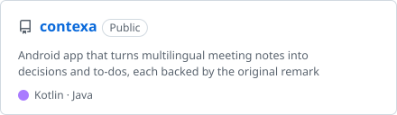
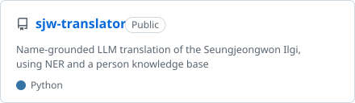
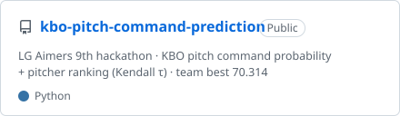
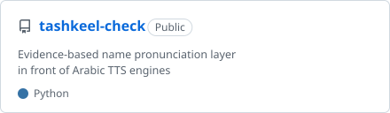

# Dain Kil

### AI Developer · NLP

**Language is my edge; ML and cloud are my tools.**  
I build AI end to end, from training models to serving them in production.

<p align="center">
  <picture>
    <source media="(prefers-color-scheme: dark)" srcset="https://raw.githubusercontent.com/dainkil/dainkil/output/pacman-contribution-graph-dark.svg">
    <source media="(prefers-color-scheme: light)" srcset="https://raw.githubusercontent.com/dainkil/dainkil/output/pacman-contribution-graph.svg">
    
  </picture>
</p>

---

## 📌 Pinned

<p align="center">
<a href="https://github.com/dainkil/contexa"><picture><source media="(prefers-color-scheme: dark)" srcset="https://raw.githubusercontent.com/dainkil/dainkil/main/assets/pins/contexa-dark.svg"><source media="(prefers-color-scheme: light)" srcset="https://raw.githubusercontent.com/dainkil/dainkil/main/assets/pins/contexa-light.svg"></picture></a>
<a href="https://github.com/dainkil/sjw-translator"><picture><source media="(prefers-color-scheme: dark)" srcset="https://raw.githubusercontent.com/dainkil/dainkil/main/assets/pins/sjw-translator-dark.svg"><source media="(prefers-color-scheme: light)" srcset="https://raw.githubusercontent.com/dainkil/dainkil/main/assets/pins/sjw-translator-light.svg"></picture></a>
<br/>
<a href="https://github.com/dainkil/kbo-pitch-command-prediction"><picture><source media="(prefers-color-scheme: dark)" srcset="https://raw.githubusercontent.com/dainkil/dainkil/main/assets/pins/kbo-pitch-command-prediction-dark.svg"><source media="(prefers-color-scheme: light)" srcset="https://raw.githubusercontent.com/dainkil/dainkil/main/assets/pins/kbo-pitch-command-prediction-light.svg"></picture></a>
<a href="https://github.com/dainkil/tashkeel-check"><picture><source media="(prefers-color-scheme: dark)" srcset="https://raw.githubusercontent.com/dainkil/dainkil/main/assets/pins/tashkeel-check-dark.svg"><source media="(prefers-color-scheme: light)" srcset="https://raw.githubusercontent.com/dainkil/dainkil/main/assets/pins/tashkeel-check-light.svg"></picture></a>
</p>

---

## 🧩 Projects

### 🗂 [Contexa](https://github.com/dainkil/contexa) | Decisions from multilingual meetings
> Pulls decisions, conditions and to-dos out of Korean · English · Arabic meeting notes; only what a person confirms against the source becomes "the current decision"

`Nov 2026 –` · solo · v0.1.0, runs locally (deployment planned)

- Android app (Compose) + Spring Boot server + Python AI worker (Claude); AI only proposes candidates, humans confirm
- Optimistic locking, idempotency keys and leased jobs guard against concurrent edits, double taps and dead workers

**Tech** `Kotlin` `Jetpack Compose` `Java 21` `Spring Boot` `PostgreSQL` `Python` `Claude API`

---

### 📜 [SJW Translator](https://github.com/dainkil/sjw-translator) | Name-grounded translation of the *Seungjeongwon Ilgi*
> NER + a person knowledge base resolve names in Classical Chinese, inject them into the LLM prompt, and a quality gate checks every name

`Mar – Sep 2026` · team of 4 · **My role: KB, modeling, backend, model serving**

- **Name accuracy** 86.9% → **92.3%** (KB-listed names **99.0%**); evaluation redesign showed the bottleneck was KB coverage, not the LLM
- **KB expansion** without LLM calls: **2,690 → 6,718 people** (precision 97.4%)
- **Serving:** ONNX INT8 NER (709MB → **178MB**, p50 **8.3ms**), Spring Boot on Redis Streams, deployed on EKS

**Tech** `Python` `PyTorch` `ONNX Runtime` `FastAPI` `Gemini API` `Spring Boot` `Redis Streams` `Kubernetes`

---

### ⚾ [KBO Pitch Command Prediction](https://github.com/dainkil/kbo-pitch-command-prediction) | LG Aimers 9th hackathon
> Command grade (Shadow / Heart / Failure) probabilities and a pitcher ranking from 29 pre-pitch columns, in 24 hours

`Sep 2026` · team of 4 · **Final 70.314, team best** · +1.79 over baseline

- Found the score gap was in the **pitcher ranking (Kendall τ)**, not the pitch term, and reframed around it
- Projection-based split of probability and pitcher score (**+4.9**) and a ball-count row term (**+1.08**), both adopted by the team

**Tech** `Python` `LightGBM` `pandas` `scikit-learn` `Empirical Bayes`

---

### 🗣 [Tashkeel Check](https://github.com/dainkil/tashkeel-check) | Name pronunciation layer for Arabic TTS
> Decides how each proper name is read, from evidence, before the TTS engine guesses; unsure names go to human review

`Oct 2026 –` · **In design** (pivoted from a document-review service)

- Found an instruction-only LLM already hit 99.9% on synthetic documents, so value moved to **evidence, verification and reuse**
- Next: baseline across 4–5 TTS engines × 3 input formats (EXP-006)

**Tech** `Python` `FastAPI` `LangGraph` `MCP` `CAMeL Tools` `PostgreSQL`

---

## 🛠 Tech Stack

### AI · ML

<a href="https://skillicons.dev">
  <picture>
    <source media="(prefers-color-scheme: dark)" srcset="https://skillicons.dev/icons?i=py%2Cpytorch&theme=dark">
    <source media="(prefers-color-scheme: light)" srcset="https://skillicons.dev/icons?i=py%2Cpytorch&theme=light">
    
  </picture>
</a>
<br/>
<sub>Python · PyTorch · ONNX Runtime</sub>

### Backend

<a href="https://skillicons.dev">
  <picture>
    <source media="(prefers-color-scheme: dark)" srcset="https://skillicons.dev/icons?i=java%2Cspring%2Cfastapi&theme=dark">
    <source media="(prefers-color-scheme: light)" srcset="https://skillicons.dev/icons?i=java%2Cspring%2Cfastapi&theme=light">
    
  </picture>
</a>
<br/>
<sub>Java · Spring Boot · Spring AI · FastAPI</sub>

### Data & Messaging

<a href="https://skillicons.dev">
  <picture>
    <source media="(prefers-color-scheme: dark)" srcset="https://skillicons.dev/icons?i=postgres%2Credis%2Ckafka&theme=dark">
    <source media="(prefers-color-scheme: light)" srcset="https://skillicons.dev/icons?i=postgres%2Credis%2Ckafka&theme=light">
    
  </picture>
</a>
<br/>
<sub>PostgreSQL · Redis · MariaDB · Kafka</sub>

### Cloud & Infra

<a href="https://skillicons.dev">
  <picture>
    <source media="(prefers-color-scheme: dark)" srcset="https://skillicons.dev/icons?i=docker%2Ckubernetes%2Caws&theme=dark">
    <source media="(prefers-color-scheme: light)" srcset="https://skillicons.dev/icons?i=docker%2Ckubernetes%2Caws&theme=light">
    
  </picture>
</a>
<br/>
<sub>Docker · Kubernetes · AWS EKS</sub>

### Frontend & Tools

<a href="https://skillicons.dev">
  <picture>
    <source media="(prefers-color-scheme: dark)" srcset="https://skillicons.dev/icons?i=vue%2Cgit%2Cgithub&theme=dark">
    <source media="(prefers-color-scheme: light)" srcset="https://skillicons.dev/icons?i=vue%2Cgit%2Cgithub&theme=light">
    
  </picture>
</a>
<br/>
<sub>Vue.js · Git · GitHub</sub>

### Languages

<!-- LANGUAGES:START -->
```text
Python            ████████████░░░░░░░░░░░░░   49.4%
Java              ██████░░░░░░░░░░░░░░░░░░░   24.6%
Kotlin            ███░░░░░░░░░░░░░░░░░░░░░░   11.7%
HTML              █░░░░░░░░░░░░░░░░░░░░░░░░    5.7%
Vue               █░░░░░░░░░░░░░░░░░░░░░░░░    2.5%
Jupyter Notebook  ░░░░░░░░░░░░░░░░░░░░░░░░░    1.7%
Shell             ░░░░░░░░░░░░░░░░░░░░░░░░░    1.7%
JavaScript        ░░░░░░░░░░░░░░░░░░░░░░░░░    1.6%
Other             ░░░░░░░░░░░░░░░░░░░░░░░░░    1.2%
```
<sub>By code size (bytes) across 9 repos · updated hourly</sub>
<!-- LANGUAGES:END -->

---

## 🌐 Spoken Languages

- **🇬🇧 English** — OPIc IH · TOEIC Speaking AL 
- **🇸🇦 Arabic**

---

## 🎓 Education & Activities

### Hankuk University of Foreign Studies (HUFS) | Ingenium College of Convergence Studies
**Mar 2022 – Aug 2027**

### SKALA | SK AX
**Jul 2026 – Dec 2026**

- AI/SW industry training program run by SK AX

### LG Aimers 9th, Phase 1 & 2 & 3 | LG AI Research
**Jun 2026 – Sep 2026**

- AI/ML coursework and online hackathon

### DAT, Data Analysis Society | President
**Sep 2025 – Jun 2026**

- Led the HUFS data analysis society
- Planned and ran study groups and capstone projects

### ITDA, Inter-university Data Analysis Club (Seoul Metropolitan Area) | Organizing Committee
**Jan 2026 – Jul 2026**

- Planned and ran activities for an inter-university data analysis club in the Seoul area

### Sports

- STROKER, inter-university swimming club · Training team · Mar 2025 – present
- HUFS Swimming Team · Vice-captain · Jan 2024 – Aug 2024
